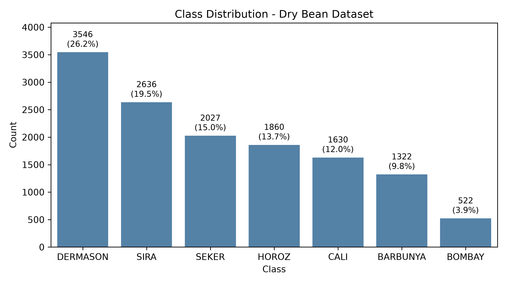
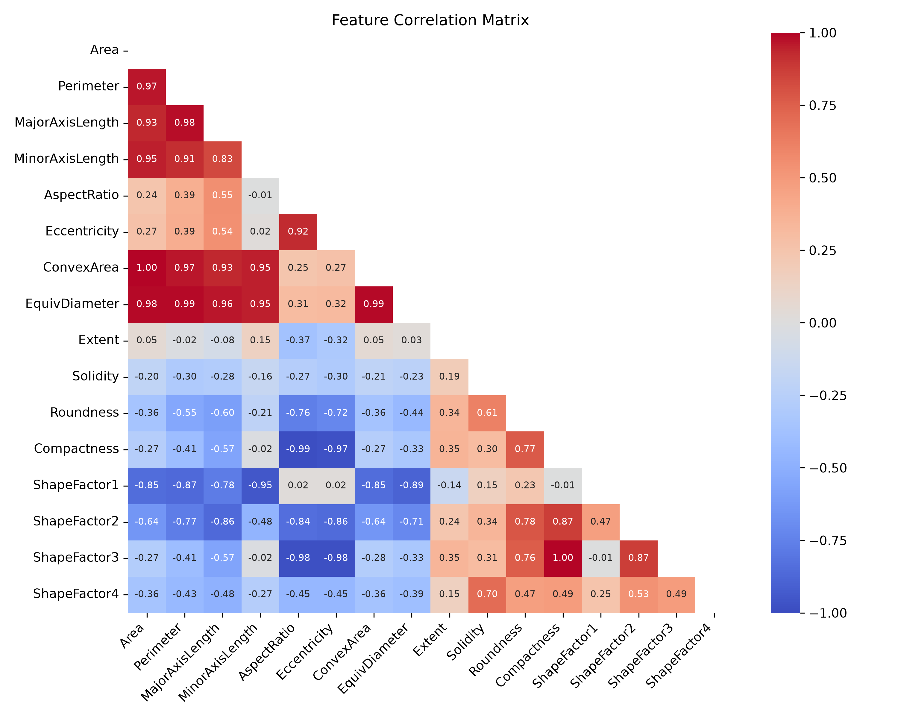
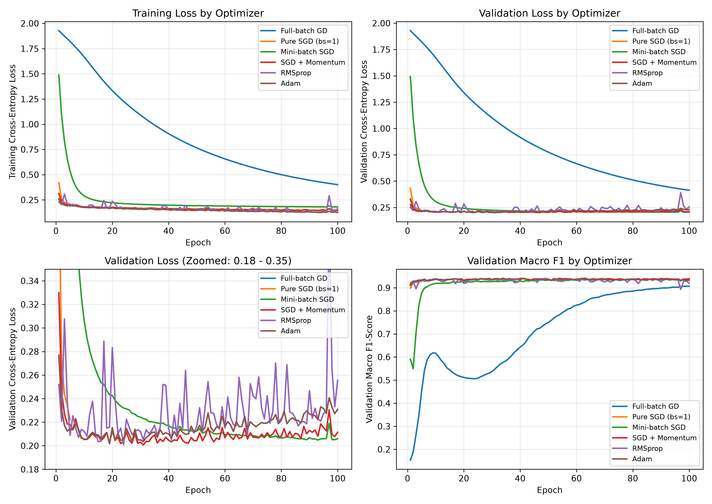
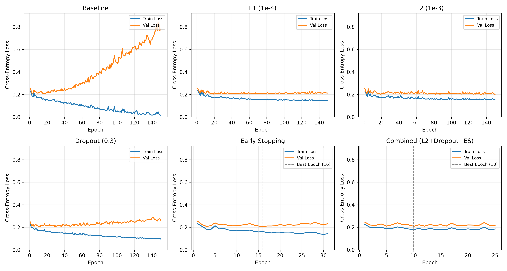
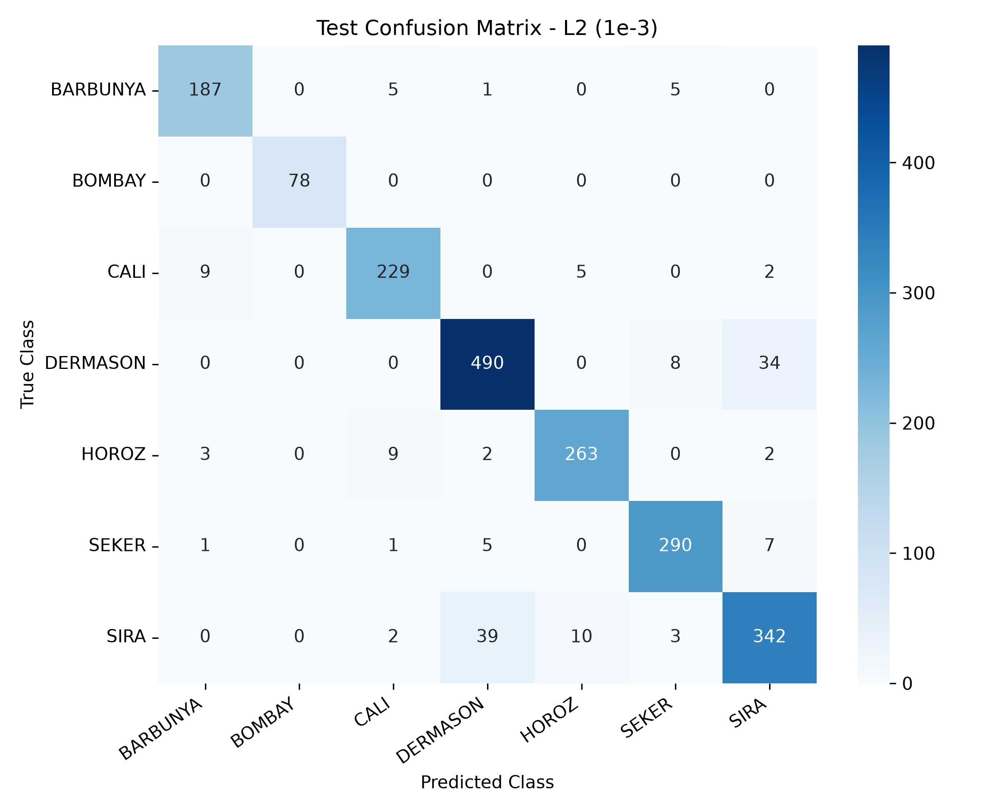

# QUESTION 1 REPORT BLUEPRINT (ENGLISH TECHNICAL VERSION)

*Note for Word assembly teammate:* Paste the `SUMMARY` paragraph below into the shared group `SUMMARY` section, then place `QUESTION 1` directly into the main body matching `Mau_bao_cao_English.docx`. Preserve the section numbering (`1.1` to `1.4`), tables (`Table 1.1` to `Table 1.3`), figures (`Figure 1.1` to `Figure 1.5`), and image files in `01-mlp-optimization-dry-bean/figures/` so the Word document and defense slides stay synchronized.

---

## SUMMARY (Question 1 Contribution)

For Question 1, this study formalizes the three-phase Backpropagation algorithm in a Multilayer Perceptron (MLP), contrasts five optimization methods (`Gradient Descent`, `SGD`/`Mini-batch SGD`, `SGD with Momentum`, `RMSprop`, and `Adam`), and examines `Overfitting` along with four prevention techniques (`L1 Regularization`, `L2 Regularization`, `Inverted Dropout`, and `Early Stopping`). Experiments are conducted in `PyTorch 2.6.0+cu124` on the `UCI Dry Bean` dataset (`13,543` deduplicated samples, `16` geometric features, `7` bean classes) using a leak-free stratified `70/15/15` split. Across six optimizer configurations on a `[128, 64]` MLP, `SGD + Momentum` achieves the lowest `Validation Loss` (`0.2007`) and highest `Validation Macro F1` (`0.9398`), while `Adam` converges earliest (`Best Epoch = 19`). On a deeper `[256, 256, 128]` MLP, `L2 (1e-3)` prevents the severe baseline overfitting (`Val Loss = 0.7806`, `Acc Gap = 8.08%`) and yields the lowest `Validation Loss` (`0.2019`, `Acc Gap = 1.52%`), achieving `Test Loss = 0.2038`, `Test Accuracy = 92.47%`, `Test Macro F1 = 93.69%`, and `Test Weighted F1 = 92.46%` on a single evaluation of the `2,032` held-out test samples.

---

# QUESTION 1. BACKPROPAGATION AND TRAINING AN MLP

## 1.1. The Backpropagation Algorithm in an MLP

### 1.1.1. Network Architecture and Notation
A Multilayer Perceptron (`MLP`, a feedforward neural network) consists of $L$ layers indexed by $l = 1, 2, \dots, L$:
* Input layer ($l = 1$): $a^1 = x \in \mathbb{R}^{d}$, where $x$ denotes the input feature vector ($d = 16$ for the `Dry Bean` task).
* Hidden layers ($l = 2, \dots, L-1$): apply a linear transformation followed by a nonlinear activation function.
* Output layer ($l = L$): produces predictions across $K$ target classes ($K = 7$ for `Dry Bean`).

For each layer $l \in \{2, \dots, L\}$, let $w_{jk}^l$ denote the weight connecting neuron $k$ in layer $(l-1)$ to neuron $j$ in layer $l$ (matrix $w^l$), $b_j^l$ the bias (vector $b^l$), $z^l$ the pre-activation linear sum, $a^l$ the post-activation output, $\sigma(\cdot)$ the activation function, $C$ the cost (loss) function, and $\alpha > 0$ the learning rate. Training repeats three phases per update step: forward propagation, backward gradient computation, and parameter update.

### 1.1.2. Phase 1: Forward Propagation
Starting from $a^1 = x$, the network computes layer activations sequentially for $l = 2, 3, \dots, L$:

$$z^l = w^l a^{l-1} + b^l, \qquad a^l = \sigma(z^l)$$

In the multiclass classification experiments of this report:
* Hidden layers use the `ReLU` (Rectified Linear Unit) activation function: $\text{ReLU}(z) = \max(0, z)$, whose derivative is `1` for $z > 0$ and `0` for $z < 0$. This mitigates vanishing gradients on positive activations while remaining computationally lightweight.
* The output layer applies `Softmax` paired with `Cross-Entropy Loss`:
  $$a_j^L = \frac{e^{z_j^L}}{\sum_{k=1}^{K} e^{z_k^L}}, \qquad C(a^L, y) = -\sum_{j=1}^{K} y_j \ln(a_j^L)$$
  where $y$ is the one-hot ground-truth vector. In `PyTorch`, `nn.CrossEntropyLoss()` takes raw linear logits $z^L$ directly and fuses `LogSoftmax` with `NLLLoss` for numerical stability.

### 1.1.3. Phase 2: Gradient Computation via the Four Backpropagation Equations
Define the layer error term $\delta_j^l \equiv \frac{\partial C}{\partial z_j^l}$ (in vector form, $\delta^l = \frac{\partial C}{\partial z^l}$). Applying the Chain Rule backward from layer $l = L$ down to $l = 2$, with $\odot$ denoting element-wise multiplication (Hadamard product), yields four core equations:

1. `(BP1)` Error at the output layer $L$:
   $$\delta^L = \nabla_a C \odot \sigma'(z^L)$$
   For `Softmax` combined with `Cross-Entropy`, this simplifies directly to $\delta^L = a^L - y$ (predicted probabilities minus one-hot true labels).

2. `(BP2)` Propagating error backward from layer $(l+1)$ to layer $l$:
   $$\delta^l = \big((w^{l+1})^T \delta^{l+1}\big) \odot \sigma'(z^l)$$
   The error $\delta^{l+1}$ is propagated back through the transposed weight matrix $(w^{l+1})^T$ and scaled element-wise by $\sigma'(z^l)$. Computing backward from $L$ to $2$ reuses $\delta^{l+1}$ without redundant Chain Rule evaluations.

3. `(BP3)` Gradient with respect to bias $b^l$:
   $$\frac{\partial C}{\partial b_j^l} = \delta_j^l \quad \Longleftrightarrow \quad \frac{\partial C}{\partial b^l} = \delta^l$$

4. `(BP4)` Gradient with respect to weight $w_{jk}^l$:
   $$\frac{\partial C}{\partial w_{jk}^l} = a_k^{l-1} \delta_j^l \quad \Longleftrightarrow \quad \frac{\partial C}{\partial w^l} = \delta^l (a^{l-1})^T$$

### 1.1.4. Phase 3: Parameter Update
Given a mini-batch of $m$ samples $\{x^{(i)}, y^{(i)}\}_{i=1}^{m}$, the batch-averaged gradients for layer $l$ are:

$$g_{w^l} = \frac{1}{m} \sum_{i=1}^{m} \delta^{l,(i)} \big(a^{l-1,(i)}\big)^T, \qquad g_{b^l} = \frac{1}{m} \sum_{i=1}^{m} \delta^{l,(i)}$$

Parameters are updated in the negative gradient direction:

$$w^l \leftarrow w^l - \alpha \, g_{w^l}, \qquad b^l \leftarrow b^l - \alpha \, g_{b^l}$$

---

## 1.2. Optimization Methods

Let $\theta_t$ denote the parameter vector at update step $t$, $g_t = \nabla_\theta C(\theta_t)$ the gradient at step $t$, and $\alpha$ the learning rate.

### 1.2.1. `Gradient Descent (GD)` (Full-Batch GD)
Computes the exact gradient $g_t = \frac{1}{N} \sum_{i=1}^{N} \nabla_\theta C^{(i)}(\theta_t)$ across all $N$ training samples (`9,480` samples in our experiments) before performing a single update per epoch:

$$\theta_{t+1} = \theta_t - \alpha g_t$$

Update steps are smooth and deterministic, but performing only `1` update per epoch makes convergence per epoch slow and increases susceptibility to stalling on flat plateaus or saddle points.

### 1.2.2. `Stochastic Gradient Descent (Pure SGD)` and `Mini-batch SGD`
Both methods share the update rule $\theta_{t+1} = \theta_t - \alpha g_t$, differing only in the batch size $m$ used to estimate $g_t$:
* `Pure SGD` ($m = 1$): updates after every individual sample (`9,480` updates per epoch). Gradient noise helps escape shallow local minima, but updates oscillate heavily and cannot exploit GPU batch parallelism, resulting in slow wall-clock execution.
* `Mini-batch SGD` ($1 < m \ll N$, set to $m = 64$, yielding `149` updates per epoch): balances gradient variance reduction against efficient GPU vectorization.

### 1.2.3. `SGD with Momentum`
Maintains a velocity vector $v_t$ accumulating exponentially weighted past gradients with momentum factor $\beta$ (typically $\beta = 0.9$):

$$v_t = \beta v_{t-1} + g_t, \qquad \theta_{t+1} = \theta_t - \alpha v_t$$

Momentum reinforces consistent descent directions while damping transverse oscillations across narrow ravines, accelerating convergence compared to standard `Mini-batch SGD`.

### 1.2.4. `RMSprop` (Root Mean Square Propagation)
Maintains a running exponential moving average of squared gradients $s_t$ per parameter coordinate using decay factor $\rho$ (named `alpha = 0.99` in `torch.optim.RMSprop`, distinct from the learning rate `lr`):

$$s_t = \rho s_{t-1} + (1 - \rho) g_t^2, \qquad \theta_{t+1} = \theta_t - \frac{\alpha}{\sqrt{s_t} + \epsilon} g_t$$

where $\epsilon = 10^{-8}$ prevents division by zero. Coordinates with large or oscillating gradients receive smaller effective step sizes, while gentler directions receive larger steps. Without numerator momentum, late-epoch gradient spikes may occur if $\alpha$ stays fixed.

### 1.2.5. `Adam` (Adaptive Moment Estimation)
Combines first-moment momentum ($m_t$) and second-moment adaptive scaling ($v_t$) with bias correction ($\beta_1 = 0.9$, $\beta_2 = 0.999$, $\epsilon = 10^{-8}$):

$$m_t = \beta_1 m_{t-1} + (1 - \beta_1) g_t, \qquad v_t = \beta_2 v_{t-1} + (1 - \beta_2) g_t^2$$

$$\hat{m}_t = \frac{m_t}{1 - \beta_1^t}, \qquad \hat{v}_t = \frac{v_t}{1 - \beta_2^t}$$

$$\theta_{t+1} = \theta_t - \alpha \frac{\hat{m}_t}{\sqrt{\hat{v}_t} + \epsilon}$$

Because $m_0 = 0$ and $v_0 = 0$, early estimates such as $v_1 = (1 - \beta_2)g_1^2 = 0.001 g_1^2$ are heavily biased toward zero. Dividing by $(1 - \beta_1^t)$ and $(1 - \beta_2^t)$ restores the expected scale early on and decays to unity as $t$ grows ($\beta^t \to 0$).

---

## 1.3. Overfitting and Prevention Techniques

### 1.3.1. Overfitting Mechanism and the Bias-Variance Trade-off
Overfitting occurs when an MLP possesses greater parameter capacity than the complexity of the underlying data. The network amplifies weight magnitudes $w$ to bend decision boundaries around sample-specific noise in the training set. On learning curves, `Train Loss` approaches `0` while `Val Loss` reverses upward, widening the generalization accuracy gap (`Acc Gap = Train Acc - Val Acc`).

Regularization techniques follow the Bias-Variance Trade-off: constraining effective model capacity (keeping weights small or limiting neuron co-adaptation) accepts slightly higher training error in exchange for lower variance and better generalization on unseen data.

### 1.3.2. `L1 Regularization`
Adds the sum of absolute weights $w$ (excluding biases $b$) to the training objective with penalty coefficient $\lambda_1 > 0$:

$$C_{\text{L1}} = C + \lambda_1 \sum |w| \quad \Longrightarrow \quad \frac{\partial C_{\text{L1}}}{\partial w} = \frac{\partial C}{\partial w} + \lambda_1 \cdot \text{sign}(w)$$

Because the penalty derivative remains constant at $\pm \lambda_1$ regardless of weight magnitude, `L1` pushes weakly informative weights to near `0`, inducing sparsity and implicit feature selection.

### 1.3.3. `L2 Regularization` and Weight Decay
Adds the sum of squared weights $w$ (excluding biases $b$) to the training objective with coefficient $\lambda_2 > 0$:

$$C_{\text{L2}} = C + \frac{\lambda_2}{2} \sum w^2 \quad \Longrightarrow \quad w \leftarrow (1 - \alpha \lambda_2) w - \alpha \frac{\partial C}{\partial w}$$

Multiplying $w$ by $(1 - \alpha \lambda_2) < 1$ shrinks weights smoothly at each step (weight decay), distributing small magnitudes across features rather than forcing exact zeros. Note that the closed-form update above corresponds to `SGD`; in Experiment 2 with `Adam`, the term $\frac{\lambda_2}{2}\sum w^2$ is added directly to the loss before `loss.backward()` (coupled L2 regularization, distinct from decoupled weight decay in `AdamW`).

### 1.3.4. `Dropout` (Inverted Dropout)
During training (`model.train()`), each hidden layer samples a random binary mask $r^l \sim \text{Bernoulli}(1 - p)$ (dropping fraction $p = 0.3$ of neurons and keeping $70\%$) and rescales outputs by $(1 - p)$ to preserve the expected activation magnitude:

$$\tilde{a}^l = \frac{r^l \odot a^l}{1 - p}$$

During validation and testing (`model.eval()`), $100\%$ of neurons remain active and unscaled $a^l$ is passed forward. This prevents rigid co-adaptation among hidden units.

### 1.3.5. `Early Stopping` with Best-Checkpoint Restoration
Validation loss is monitored after each epoch, counting an improvement only when:

$$\text{Val Loss}_t < \text{Best Val Loss} - \text{min\_delta} \qquad (\text{min\_delta} = 10^{-4})$$

If `patience = 15` consecutive epochs pass without improvement, training halts and restores $\theta^* = \theta_{\text{best\_epoch}}$.

---

## 1.4. Illustrative Code, Experimental Setup, and Results

### 1.4.1. UCI Dry Bean Dataset and Leak-Free Preprocessing
Experiments use the public **UCI Dry Bean Dataset** (`ID: 602`, Koklu & Ozkan, 2020), not previously used in class labs. In automated agricultural sorting, conveyor-belt vision systems extract `16` geometric measurements per dry bean to classify it into `7` varieties: `DERMASON`, `SIRA`, `SEKER`, `HOROZ`, `CALI`, `BARBUNYA`, and `BOMBAY`.

Exploratory analysis and data cleaning (`Cells 3-5` in the notebook) show:
* Raw dataset size is `13,611` samples across `16` continuous features with `0` missing values. Removing `68` exact duplicate rows (with zero label conflicts) yields `13,543` clean samples.
* Feature scales differ by more than $10^8$ times (`Area` ranges from `20,420.0` to `254,616.0` with `std = 29,392.44`, whereas `ShapeFactor2` spans `0.0006` to `0.0037`), requiring standardization prior to MLP training.
* Class distribution exhibits an imbalance ratio of `6.79` between `DERMASON` (`3,546` samples, `26.18%`) and `BOMBAY` (`522` samples, `3.85%`) (Figure 1.1). Therefore, `Macro F1` is reported alongside `Accuracy` and `Weighted F1` to weight all seven classes equally.
* Several feature pairs display strong multicollinearity (`Area` and `ConvexArea`: `1.00`; `Compactness` and `ShapeFactor3`: `1.00`; `AspectRatio` and `Compactness`: `-0.99`, Figure 1.2).
* High-magnitude observations (`Area` up to `254,616.0`) belong to the naturally large `BOMBAY` variety rather than sensor noise and are preserved in full.



*Figure 1.1 (`01_class_distribution.png`): Class distribution across `13,543` clean dry bean samples (imbalance ratio `6.79`).*



*Figure 1.2 (`02_feature_correlation_heatmap.png`): Correlation heatmap across the 16 geometric features showing strongly collinear feature groups.*

Leak-free splitting and scaling: stratified splitting (`stratify=y`, `SEED = 42`, `70/15/15`) partitions the data into `Train` (`9,480`), `Validation` (`2,031`), and `Test` (`2,032`) sets with `0` overlapping rows between `Train` and `Val/Test`. A `StandardScaler` is fit strictly on `Train` (`Train scaled max |mean| = 3.45e-08`, `max |std - 1| = 1.55e-06`; `Val scaled max |mean| = 0.0300`) before transforming `Validation` and `Test`.

### 1.4.2. MLP Architecture, Illustrative Code, and Backpropagation Verification
Experiments run in `Python 3.12.10` and `PyTorch 2.6.0+cu124` on an `NVIDIA GeForce RTX 3050 Laptop GPU` with deterministic seeding (`SEED = 42`) and GPU timing synchronized via `torch.cuda.synchronize()`. The core PyTorch implementation below (excerpted from `Cells 7-8` of `mlp_optimization_study.ipynb`) defines the `MLP` architecture and three-phase training update with explicit L1/L2 penalties on `"weight"` parameters only:

```python
class MLP(nn.Module):
    def __init__(self, in_dim, hidden_dims, out_dim, dropout_rate=0.0):
        super().__init__()
        layers, prev_dim = [], in_dim
        for h_dim in hidden_dims:
            layers.extend([nn.Linear(prev_dim, h_dim), nn.ReLU(), nn.Dropout(dropout_rate)])
            prev_dim = h_dim
        layers.append(nn.Linear(prev_dim, out_dim))
        self.net = nn.Sequential(*layers)

    def forward(self, x):
        return self.net(x)

criterion = nn.CrossEntropyLoss()
optimizer = torch.optim.Adam(model.parameters(), lr=0.001)

# One mini-batch training step (Forward -> Loss + L1/L2 -> Backward -> Update)
optimizer.zero_grad()
logits = model(xb)
loss = criterion(logits, yb)
if l1_lambda > 0 or l2_lambda > 0:
    reg = 0.0
    for name, param in model.named_parameters():
        if "weight" in name:
            if l1_lambda > 0:
                reg = reg + l1_lambda * param.abs().sum()
            if l2_lambda > 0:
                reg = reg + 0.5 * l2_lambda * (param ** 2).sum()
    loss = loss + reg
loss.backward()
optimizer.step()
```

Each experiment shares identical initial weights across all configurations:
* Experiment 1 (Optimizers): `16 -> 128 -> 64 -> 7` with $16\times128+128 + 128\times64+64 + 64\times7+7 = 10,887$ parameters.
* Experiment 2 (Regularization): `16 -> 256 -> 256 -> 128 -> 7` with $16\times256+256 + 256\times256+256 + 256\times128+128 + 128\times7+7 = 103,943$ parameters (nearly 10x capacity to induce strong baseline overfitting).

Three-phase Backpropagation verification (`Cell 9`) on a 64-sample batch using `[128, 64]`:
* Phase 1 (Forward): output shape is `(64, 7)` and initial loss is `1.9553`, matching theoretical uniform initialization ($\ln 7 \approx 1.9459$).
* Phase 2 (Backward): layer weight gradient norms are `0.165665`, `0.424576`, and `0.275081`. Comparing manual derivatives computed via BP1-BP4 against `PyTorch Autograd` yields maximum absolute differences of `dW = 3.73e-09` and `db = 1.49e-08`.
* Phase 3 (Update): one SGD step (`lr = 0.1`) lowers the batch loss from `1.9553` to `1.9220`.

### 1.4.3. Experiment 1: Comparison of Six Optimizer Configurations on `MLP [128, 64]`
Each optimizer family uses its own stable learning-rate scale: `Full-batch GD` averages gradients over all `9,480` samples (low variance) and tolerates `LR = 0.100`; `Mini-batch SGD` and `SGD + Momentum` (`bs = 64`) use `LR = 0.010`; `Pure SGD (bs = 1)` uses `LR = 0.001` to avoid per-sample divergence; `RMSprop` (`alpha = 0.99`) and `Adam` use standard `LR = 0.001` because step sizes are normalized by $\sqrt{s_t}$ and $\sqrt{\hat{v}_t}$. `Pure SGD` runs for `5` epochs because `5` epochs equal `9,480 x 5 = 47,400` sequential updates, already `3.2` times more parameter updates than `100` epochs of `bs = 64` mini-batch training (`149 x 100 = 14,900` updates).

| Optimizer | Batch Size | LR | Epochs | Best Epoch | Best Val Loss | Best Val Macro F1 | Final Val Acc | Final Val Macro F1 | Time (s) |
| :--- | :---: | :---: | :---: | :---: | :---: | :---: | :---: | :---: | :---: |
| `Full-batch GD` | `9,480` | `0.100` | `100` | `100` | `0.4137` | `0.9068` | `0.8932` | `0.9068` | `1.25` |
| `Pure SGD (bs=1)` | `1` | `0.001` | `5` | `5` | `0.2222` | `0.9289` | `0.9178` | `0.9289` | `62.91` |
| `Mini-batch SGD` | `64` | `0.010` | `100` | `93` | `0.2049` | `0.9378` | `0.9286` | `0.9376` | `21.15` |
| `SGD + Momentum` ($\beta=0.9$) | `64` | `0.010` | `100` | `31` | **`0.2007`** | **`0.9398`** | **`0.9291`** | **`0.9393`** | `22.76` |
| `RMSprop` (`alpha=0.99`) | `64` | `0.001` | `100` | `24` | `0.2010` | `0.9395` | `0.9104` | `0.9195` | `25.57` |
| `Adam` | `64` | `0.001` | `100` | **`19`** | `0.2017` | `0.9372` | `0.9222` | `0.9328` | `25.83` |

*Table 1.1: Validation comparison of six optimizer configurations on the `[128, 64]` MLP.*



*Figure 1.3 (`03_optimizer_comparison.png`): Learning curves of six optimizer configurations: Training Loss (top left), Validation Loss (top right), Zoomed Validation Loss `[0.18, 0.35]` (bottom left), and Validation Macro F1 (bottom right).*

Key findings from Experiment 1 (Table 1.1 and Figure 1.3):
* In the `Training Loss` subplot (top left, Figure 1.3), `Full-batch GD` remains near `0.40` after `100` epochs, indicating underfitting from slow per-epoch convergence, whereas all mini-batch and adaptive methods descend below `0.20`.
* `Full-batch GD` finishes fastest in wall-clock time (`1.25s`) with only one step per epoch, but achieves the weakest validation score (`Best Val Loss = 0.4137`, `Macro F1 = 0.9068`) and exhibits a temporary dip around epochs `15-25` in `Validation Macro F1` (bottom right, Figure 1.3).
* `Pure SGD (bs=1)` takes `62.91s` for just `5` epochs (roughly `3x` slower than `100` epochs of mini-batch methods) due to sequential per-sample overhead on GPU, yet reaches `Val Loss = 0.2222` thanks to `47,400` updates.
* `Mini-batch SGD` resolves the GPU throughput bottleneck (`21.15s` for `100` epochs) and reaches `Best Val Loss = 0.2049` slowly at epoch `93`.
* `SGD + Momentum` delivers the best overall generalization: lowest `Best Val Loss` (`0.2007`) and highest `Best Val Macro F1` (`0.9398`) at epoch `31`, maintaining the smoothest and lowest trajectory in the zoomed validation panel through epoch `100` (`Final Val Acc = 0.9291`).
* `Adam` converges earliest (`Best Epoch = 19`, `Best Val Loss = 0.2017`), though holding `LR = 0.001` constant until epoch `100` introduces mild late-epoch drift (`Final Val Macro F1` drops from `0.9372` to `0.9328`).
* `RMSprop` drops rapidly early (`Best Epoch = 24`, `Best Val Loss = 0.2010`), but without momentum smoothing it exhibits jagged oscillations and sharp late spikes around epochs `97-99` in the zoomed plot, lowering `Final Val Acc` to `0.9104`.

### 1.4.4. Experiment 2: Comparison of Six Overfitting Prevention Configurations on `MLP [256, 256, 128]`
All six configurations train with `Adam (lr = 0.001)`, `batch_size = 64`, up to `150` epochs from shared `init_state_exp2`. While L1/L2 penalties are included in the training objective during updates, all `Train Loss` and `Val Loss` values logged in Table 1.2 and Figure 1.4 measure pure `Cross-Entropy Loss` in `model.eval()` mode for a consistent comparison on a single scale. `Sparsity (%)` measures the fraction of weight entries with $|w| < 10^{-3}$.

| Configuration | Stopped Epoch | Train Loss | Val Loss | Train Acc | Val Acc | Acc Gap | Val Macro F1 | Sparsity (%) |
| :--- | :---: | :---: | :---: | :---: | :---: | :---: | :---: | :---: |
| `Baseline` | `150` | `0.0166` | `0.7806` | `0.9961` | `0.9153` | `0.0808` | `0.9290` | `0.66%` |
| `L1 (1e-4)` | `150` | `0.1445` | `0.2132` | `0.9447` | **`0.9301`** | `0.0146` | **`0.9395`** | **`96.80%`** |
| `L2 (1e-3)` *(Selected)* | `150` | `0.1524` | **`0.2019`** | `0.9434` | `0.9281` | `0.0152` | `0.9375` | `88.80%` |
| `Dropout (0.3)` | `150` | `0.0960` | `0.2642` | `0.9605` | `0.9261` | `0.0344` | `0.9377` | `0.56%` |
| `Early Stopping` (`Best Ep 16`) | `31` | `0.1615` | `0.2077` | `0.9406` | `0.9271` | `0.0135` | `0.9355` | `1.21%` |
| `Combined (L2+Dropout+ES)` (`Best Ep 10`) | `25` | `0.1817` | `0.2091` | `0.9346` | `0.9261` | **`0.0085`** | `0.9361` | `5.88%` |

*Table 1.2: Overfitting prevention comparison on the `[256, 256, 128]` MLP (`103,943` parameters).*



*Figure 1.4 (`04_regularization_comparison.png`): Train Loss (blue) and Validation Loss (orange) plotted on shared vertical axes; dashed lines in the last two panels mark the restored Best Epoch.*

Key findings from Experiment 2 (Table 1.2 and Figure 1.4):
* `Baseline` suffers severe overfitting: `Train Loss` falls to `0.0166` (`Train Acc = 99.61%`), while `Val Loss` climbs steadily past epoch `15` to `0.7806` (top left, Figure 1.4), widening `Acc Gap` to `8.08%` and degrading `Val Acc` to `91.53%`.
* `L1 (1e-4)` drives `96.80%` of weights into $|w| < 10^{-3}$ via its constant $\pm \lambda_1$ penalty gradient, pruning redundant collinear weights, shrinking `Acc Gap` to `1.46%`, and achieving the highest `Val Acc` (`0.9301`) and `Val Macro F1` (`0.9395`).
* `L2 (1e-3)` achieves the lowest `Val Loss` (`0.2019`), holding a flat validation curve through epoch `150` (top right, Figure 1.4) with `Acc Gap = 1.52%` and `88.80%` sparsity. Smooth shrinkage preserves informative small weights and improves probability calibration over `L1`.
* `Dropout (0.3)` curbs `Val Loss` to `0.2642` (`Acc Gap = 3.44%`) relative to `Baseline` (`0.7806`), though on a `103,943`-parameter network a gradual upward drift remains by epoch `150` (bottom left, Figure 1.4).
* `Early Stopping` (`patience = 15`) halts training at epoch `31` and restores weights from epoch `16` (bottom center, Figure 1.4), maintaining `Val Loss = 0.2077` and `Acc Gap = 1.35%` without weight penalties (`Sparsity = 1.21%`).
* `Combined (L2+Dropout+ES)` yields the smallest generalization gap (`Acc Gap = 0.85%`), but stochastic `Dropout` fluctuations cause `patience = 15` to stop early at epoch `25` (restoring epoch `10`, bottom right, Figure 1.4) before reaching the lower `Val Loss` of standalone `L2 (1e-3)`.

### 1.4.5. Validation-Based Model Selection and Final Test Evaluation
Following strict validation-only model selection based on lowest `Val Loss`, `L2 (1e-3)` (`Val Loss = 0.2019`, `Val Acc = 0.9281`, `Val Macro F1 = 0.9375`) is selected and evaluated once on the `2,032` held-out test samples:
* `Test Loss = 0.2038` (within `0.0019` of `Val Loss = 0.2019`, confirming consistent generalization).
* `Test Accuracy = 0.9247` (`92.47%`), `Test Macro F1 = 0.9369` (`93.69%`), `Test Weighted F1 = 0.9246` (`92.46%`).

| Class | Precision | Recall | F1-Score | Support |
| :--- | :---: | :---: | :---: | :---: |
| `BARBUNYA` | `0.9350` | `0.9444` | `0.9397` | `198` |
| `BOMBAY` | **`1.0000`** | **`1.0000`** | **`1.0000`** | `78` |
| `CALI` | `0.9309` | `0.9347` | `0.9328` | `245` |
| `DERMASON` | `0.9125` | `0.9211` | `0.9167` | `532` |
| `HOROZ` | `0.9460` | `0.9427` | `0.9443` | `279` |
| `SEKER` | `0.9477` | `0.9539` | `0.9508` | `304` |
| `SIRA` | `0.8837` | `0.8636` | `0.8736` | `396` |
| **Accuracy** | - | - | **`0.9247`** | **`2,032`** |
| **Macro Avg** | `0.9365` | `0.9372` | **`0.9369`** | **`2,032`** |
| **Weighted Avg** | `0.9245` | `0.9247` | **`0.9246`** | **`2,032`** |

*Table 1.3: Per-class Test classification report for the selected `L2 (1e-3)` model (`2,032` samples).*



*Figure 1.5 (`05_test_confusion_matrix.png`): Test confusion matrix of the selected `L2 (1e-3)` model across `2,032` test samples.*

Test performance and error analysis (Table 1.3 and Figure 1.5):
* `Test Macro F1` (`0.9369`) exceeds `Test Weighted F1` (`0.9246`) because the smallest minority class `BOMBAY` (`78` samples) achieves a perfect `1.0000` F1-score, raising the unweighted mean, whereas the two largest classes `DERMASON` (`532` samples, `0.9167`) and `SIRA` (`396` samples, `0.8736`) together account for `45.7%` of the test set and pull down the support-weighted average.
* Preserving naturally large `BOMBAY` samples enables `78/78` exact classification (`100%`). Four varieties (`SEKER: 0.9508`, `HOROZ: 0.9443`, `BARBUNYA: 0.9397`, `CALI: 0.9328`) exceed `0.93` F1-score.
* The top three confused pairs are `SIRA -> DERMASON` (`39` samples), `DERMASON -> SIRA` (`34` samples), and `SIRA -> HOROZ` (`10` samples). Bidirectional confusion between `SIRA` and `DERMASON` (`73` samples total) explains the lower `SIRA` F1-score (`0.8736`).

### 1.4.6. Limitations and Reproducibility Instructions
* **Limitations:** The `UCI Dry Bean` dataset provides only `16` 2D geometric shape descriptors without color or surface-texture attributes, causing natural overlap between similar small-to-medium varieties such as `SIRA` and `DERMASON`. Additionally, using fixed `LR = 0.001` with `patience = 15` terminated `Combined (L2+Dropout+ES)` early at epoch `25`. Incorporating color histograms (`RGB/HSV`) and learning-rate scheduling (`ReduceLROnPlateau`) are direct extensions to address these issues.
* **Reproducibility:** Code and figures are hosted at `https://github.com/DoQuocTrung06/dl-optimization-and-ecg-arrhythmia` on branch `mlp-optimization-trung`. Install dependencies from `requirements.txt` (`Python 3.12`, `PyTorch 2.6.0+cu124`, `scikit-learn`, `pandas`, `matplotlib`, `seaborn`, `ucimlrepo`), select kernel `dl-ecg-mlp`, and run all `17` cells sequentially in `01-mlp-optimization-dry-bean/mlp_optimization_study.ipynb`. Deterministic settings (`SEED = 42`, `cudnn.deterministic = True`) reproduce the splits, training runs, and all five `300 DPI` figures.

---

## REFERENCES (Question 1)

1. Koklu, M., & Ozkan, I. A. (2020). Multiclass classification of dry beans using computer vision and machine learning techniques. *Computers and Electronics in Agriculture*, 174, 105507. UCI Machine Learning Repository (`ID: 602`).
2. Le Anh Cuong, Ton Duc Thang University (TDTU). *Lecture 10: Neural Networks and Backpropagation Algorithm* & *Lecture 11-12: Deep Learning Introduction*, Introduction to Machine Learning (`503044`).
3. Rumelhart, D. E., Hinton, G. E., & Williams, R. J. (1986). Learning representations by back-propagating errors. *Nature*, 323(6088), 533-536.
4. Kingma, D. P., & Ba, J. (2015). Adam: A method for stochastic optimization. *International Conference on Learning Representations (ICLR)*.
5. Srivastava, N., Hinton, G., Krizhevsky, A., Sutskever, I., & Salakhutdinov, R. (2014). Dropout: A simple way to prevent neural networks from overfitting. *Journal of Machine Learning Research*, 15(1), 1929-1958.
6. Paszke, A., et al. (2019). PyTorch: An imperative style, high-performance deep learning library. *Advances in Neural Information Processing Systems (NeurIPS)*, 32.
