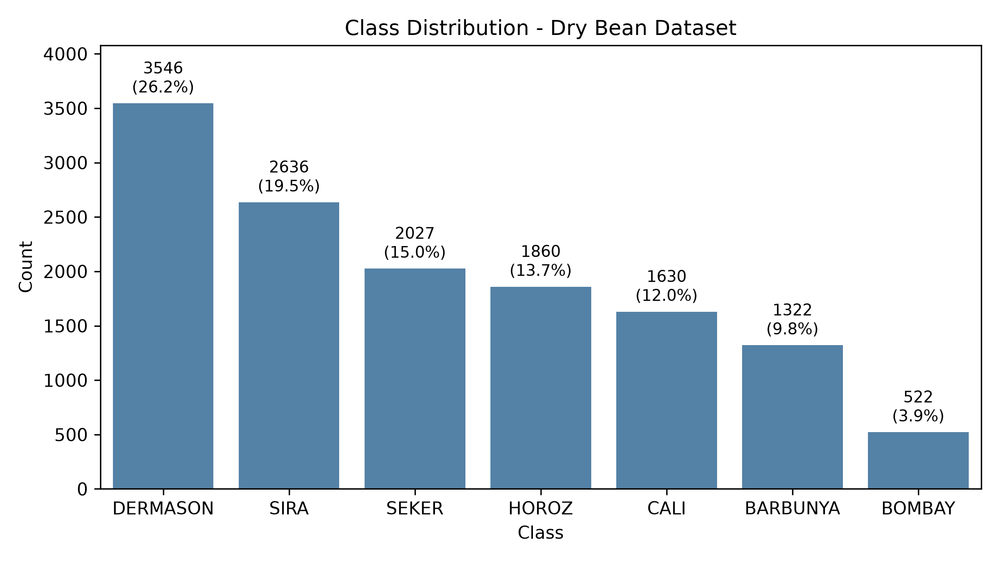
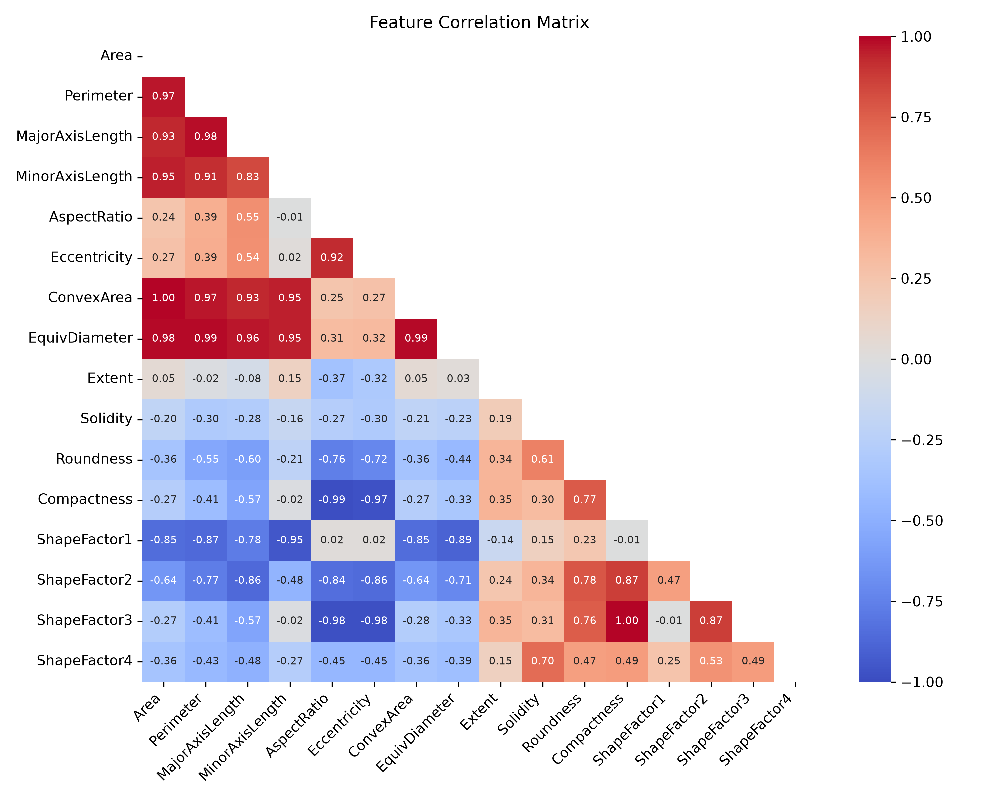
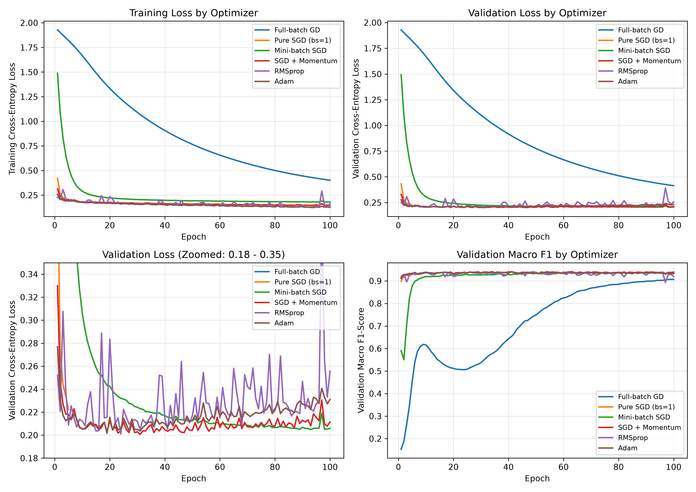
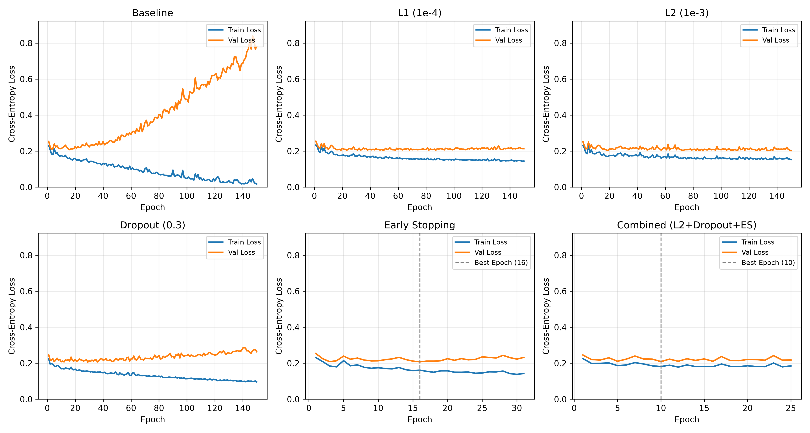
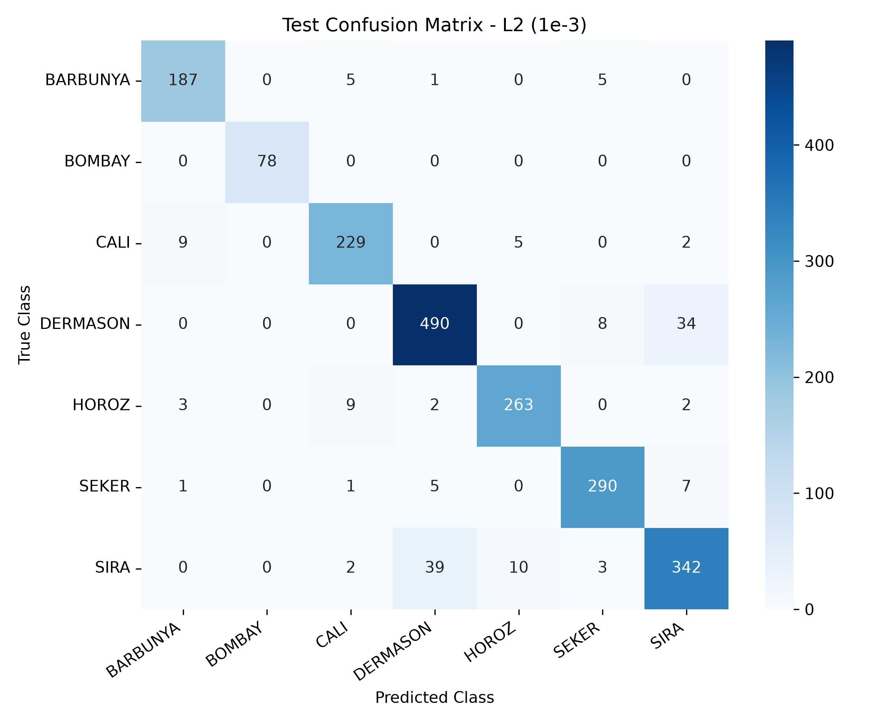

# BẢN THIẾT KẾ BÁO CÁO CÂU 1 (DÙNG CHUNG CHO BÁO CÁO WORD & SLIDE THUYẾT TRÌNH)

*Ghi chú bàn giao cho thành viên ghép Word:* Tài liệu này là nội dung trọn vẹn của phần `QUESTION 1` theo đúng khung `Mau_bao_cao_English.docx` (phần `SUMMARY` và `REFERENCES` ở cuối tài liệu sẽ được gộp chung với Câu 2). Khi dịch sang Tiếng Anh và dán vào file Word của nhóm, giữ nguyên hệ thống đánh số mục (`1.1` đến `1.4`), bảng (`Bảng 1.1` đến `Bảng 1.3`), hình (`Hình 1.1` đến `Hình 1.5`) và tên file ảnh tương ứng trong thư mục `01-mlp-optimization-dry-bean/figures/` để đồng bộ tuyệt đối với Slide thuyết trình vấn đáp.

---

# QUESTION 1. BACKPROPAGATION AND TRAINING AN MLP

## 1.1. Thuật toán *Backpropagation* (Lan truyền ngược) trong `MLP`

### 1.1.1. Kiến trúc mạng và quy ước ký hiệu
Một mạng *Multilayer Perceptron* (`MLP`, mạng nơ-ron đa tầng) gồm $L$ tầng được đánh chỉ số $l = 1, 2, \dots, L$:
* Tầng đầu vào (*Input Layer*, $l = 1$): $a^1 = x \in \mathbb{R}^{d}$, trong đó $x$ là véc-tơ đặc trưng đầu vào (với bài toán `Dry Bean`, $d = 16$).
* Các tầng ẩn (*Hidden Layers*, $l = 2, \dots, L-1$): biến đổi tuyến tính đầu ra từ tầng trước rồi đi qua hàm kích hoạt phi tuyến.
* Tầng đầu ra (*Output Layer*, $l = L$): xuất dự đoán cho $K$ lớp phân loại (với bài toán `Dry Bean`, $K = 7$).

Tại tầng $l \in \{2, \dots, L\}$, ký hiệu $w_{jk}^l$ là trọng số (*Weight*) nối từ nơ-ron $k$ của tầng $(l-1)$ sang nơ-ron $j$ của tầng $l$ (ma trận $w^l$), $b_j^l$ là độ lệch (*Bias*, véc-tơ $b^l$), $z^l$ là tổng tuyến tính trước kích hoạt, $a^l$ là đầu ra sau kích hoạt, $\sigma(\cdot)$ là hàm kích hoạt, $C$ là hàm chi phí (*Cost Function*) và $\alpha > 0$ là tốc độ học (*Learning Rate*). Quy trình huấn luyện lặp lại 3 pha cho mỗi bước cập nhật: lan truyền xuôi, tính đạo hàm ngược và cập nhật tham số.

### 1.1.2. Pha 1: *Forward Propagation* (Lan truyền xuôi)
Bắt đầu từ $a^1 = x$, mạng tính tuần tự với $l = 2, 3, \dots, L$:

$$z^l = w^l a^{l-1} + b^l, \qquad a^l = \sigma(z^l)$$

Trong thực nghiệm phân loại đa lớp của báo cáo:
* Các tầng ẩn dùng hàm kích hoạt `ReLU` (*Rectified Linear Unit*, đơn vị chỉnh lưu tuyến tính): $\text{ReLU}(z) = \max(0, z)$, đạo hàm bằng `1` khi $z > 0$ và `0` khi $z < 0$, giúp giảm thiểu hiện tượng triệt tiêu đạo hàm (*Vanishing Gradient*) và tính toán nhanh.
* Tầng đầu ra dùng hàm `Softmax` kết hợp hàm mất mát `Cross-Entropy Loss` (Entropy chéo):
  $$a_j^L = \frac{e^{z_j^L}}{\sum_{k=1}^{K} e^{z_k^L}}, \qquad C(a^L, y) = -\sum_{j=1}^{K} y_j \ln(a_j^L)$$
  với $y$ là véc-tơ *one-hot* của nhãn thật. Trong `PyTorch`, `nn.CrossEntropyLoss()` nhận trực tiếp đầu ra tuyến tính $z^L$ (*Logits*) và tự thực hiện `LogSoftmax` + `NLLLoss` để ổn định số học.

### 1.1.3. Pha 2: *Gradient Computation* (Tính đạo hàm qua 4 phương trình *Backpropagation*)
Đặt đại lượng trung gian là sai số tại tầng $l$ (*Error Term*): $\delta_j^l \equiv \frac{\partial C}{\partial z_j^l}$ (dạng véc-tơ là $\delta^l = \frac{\partial C}{\partial z^l}$). Áp dụng Quy tắc chuỗi (*Chain Rule*) theo chiều ngược từ tầng cuối $l = L$ về tầng $l = 2$, với $\odot$ là phép nhân từng phần tử (*Hadamard Product*), ta có 4 phương trình cốt lõi:

1. `(BP1)` Sai số tại tầng đầu ra $L$:
   $$\delta^L = \nabla_a C \odot \sigma'(z^L)$$
   Khi dùng `Softmax` kết hợp `Cross-Entropy`, biểu thức trên rút gọn thành $\delta^L = a^L - y$ (xác suất dự đoán trừ nhãn thật).

2. `(BP2)` Lan truyền sai số từ tầng $(l+1)$ ngược về tầng $l$:
   $$\delta^l = \big((w^{l+1})^T \delta^{l+1}\big) \odot \sigma'(z^l)$$
   Sai số $\delta^{l+1}$ được truyền ngược qua ma trận trọng số chuyển vị $(w^{l+1})^T$ rồi nhân với độ dốc hàm kích hoạt $\sigma'(z^l)$. Nhờ tính từ $L$ lùi về $2$, mạng tái sử dụng ngay $\delta^{l+1}$ đã tính ở bước trước mà không phải tính lại chuỗi đạo hàm từ đầu.

3. `(BP3)` Đạo hàm theo độ lệch $b^l$:
   $$\frac{\partial C}{\partial b_j^l} = \delta_j^l \quad \Longleftrightarrow \quad \frac{\partial C}{\partial b^l} = \delta^l$$

4. `(BP4)` Đạo hàm theo trọng số $w_{jk}^l$:
   $$\frac{\partial C}{\partial w_{jk}^l} = a_k^{l-1} \delta_j^l \quad \Longleftrightarrow \quad \frac{\partial C}{\partial w^l} = \delta^l (a^{l-1})^T$$

### 1.1.4. Pha 3: *Parameter Update* (Cập nhật tham số)
Trên một lô dữ liệu (*Mini-batch*) gồm $m$ mẫu $\{x^{(i)}, y^{(i)}\}_{i=1}^{m}$, đạo hàm trung bình theo trọng số và độ lệch của tầng $l$ là:

$$g_{w^l} = \frac{1}{m} \sum_{i=1}^{m} \delta^{l,(i)} \big(a^{l-1,(i)}\big)^T, \qquad g_{b^l} = \frac{1}{m} \sum_{i=1}^{m} \delta^{l,(i)}$$

Tham số được cập nhật theo hướng ngược *Gradient*:

$$w^l \leftarrow w^l - \alpha \, g_{w^l}, \qquad b^l \leftarrow b^l - \alpha \, g_{b^l}$$

---

## 1.2. Các phương pháp tối ưu hóa (*Optimization Methods*)

Ký hiệu $\theta_t$ là véc-tơ tham số tại bước cập nhật $t$, $g_t = \nabla_\theta C(\theta_t)$ là *Gradient* tại bước $t$, và $\alpha$ là tốc độ học.

### 1.2.1. `Gradient Descent (GD)` (Hạ dốc toàn tập)
Tính *Gradient* $g_t = \frac{1}{N} \sum_{i=1}^{N} \nabla_\theta C^{(i)}(\theta_t)$ trên toàn bộ $N$ mẫu huấn luyện (`9,480` mẫu trong thí nghiệm) trước khi cập nhật 1 lần cho mỗi vòng (*Epoch*):

$$\theta_{t+1} = \theta_t - \alpha g_t$$

Hướng cập nhật mượt và ổn định theo *Gradient* toàn cục, nhưng mỗi *Epoch* chỉ cập nhật đúng `1` bước nên hội tụ chậm theo số vòng và dễ kẹt ở vùng yên ngựa (*Saddle Points*) hoặc cực tiểu cục bộ nông.

### 1.2.2. `Stochastic Gradient Descent (Pure SGD)` và `Mini-batch SGD`
Cả hai phương pháp giữ quy tắc $\theta_{t+1} = \theta_t - \alpha g_t$, chỉ khác ở số mẫu $m$ dùng để ước lượng $g_t$:
* `Pure SGD` ($m = 1$): cập nhật ngay sau từng mẫu (`9,480` lần cập nhật mỗi *Epoch*). Nhiễu ngẫu nhiên giúp thoát cực tiểu nông nhưng đường đi dao động mạnh và không tận dụng được xử lý song song trên GPU nên thời gian chạy thực tế rất chậm.
* `Mini-batch SGD` ($1 < m \ll N$, thí nghiệm dùng $m = 64$, tương ứng `149` bước cập nhật mỗi *Epoch*): cân bằng giữa độ ổn định của ước lượng *Gradient* và khả năng tính toán vector hóa trên GPU.

### 1.2.3. `SGD with Momentum` (*SGD* có Quán tính)
Duy trì biến vận tốc $v_t$ tích lũy *Gradient* quá khứ theo hệ số quán tính $\beta$ (thường $\beta = 0.9$):

$$v_t = \beta v_{t-1} + g_t, \qquad \theta_{t+1} = \theta_t - \alpha v_t$$

Thành phần quán tính giúp khuếch đại bước đi theo các chiều có độ dốc nhất quán và triệt tiêu dao động ngang tại các hẻm dốc hẹp (*Ravines*), tăng tốc hội tụ so với `Mini-batch SGD`.

### 1.2.4. `RMSprop` (*Root Mean Square Propagation*)
Duy trì trung bình trượt bình phương *Gradient* $s_t$ theo từng chiều tham số với hệ số phân rã $\rho$ (trong `torch.optim.RMSprop` tham số này được đặt tên là `alpha = 0.99`, khác với tốc độ học `lr`):

$$s_t = \rho s_{t-1} + (1 - \rho) g_t^2, \qquad \theta_{t+1} = \theta_t - \frac{\alpha}{\sqrt{s_t} + \epsilon} g_t$$

trong đó $\epsilon = 10^{-8}$ tránh chia cho `0`. Chiều nào có đạo hàm lớn và dao động mạnh sẽ bị chia cho mẫu số lớn để tự thu nhỏ bước nhảy; ngược lại chiều ít dao động có bước nhảy lớn hơn. Do thiếu quán tính ở tử số, cuối quá trình huấn luyện có thể xuất hiện gai dao động nếu $\alpha$ cố định.

### 1.2.5. `Adam` (*Adaptive Moment Estimation*)
Kết hợp quán tính bậc một ($m_t$) của `Momentum` và bước nhảy thích nghi bậc hai ($v_t$) của `RMSprop` kèm hiệu chỉnh độ chệch (*Bias Correction*) với $\beta_1 = 0.9$, $\beta_2 = 0.999$, $\epsilon = 10^{-8}$:

$$m_t = \beta_1 m_{t-1} + (1 - \beta_1) g_t, \qquad v_t = \beta_2 v_{t-1} + (1 - \beta_2) g_t^2$$

$$\hat{m}_t = \frac{m_t}{1 - \beta_1^t}, \qquad \hat{v}_t = \frac{v_t}{1 - \beta_2^t}$$

$$\theta_{t+1} = \theta_t - \alpha \frac{\hat{m}_t}{\sqrt{\hat{v}_t} + \epsilon}$$

Do $m_0 = 0, v_0 = 0$, ở các bước đầu ($t$ nhỏ) giá trị $v_1 = (1 - \beta_2)g_1^2 = 0.001 g_1^2$ bị kéo lệch sát về `0`. Hai bước chia cho $(1 - \beta_1^t)$ và $(1 - \beta_2^t)$ khôi phục đúng độ lớn kỳ vọng ban đầu, và tự triệt tiêu khi $t$ tăng lớn ($\beta^t \to 0$).

---

## 1.3. Hiện tượng *Overfitting* (Quá khớp) và các kỹ thuật phòng chống

### 1.3.1. Cơ chế *Overfitting* và *Bias-Variance Trade-off*
*Overfitting* (Quá khớp) xảy ra khi mạng `MLP` có số lượng tham số lớn hơn nhu cầu thực tế của bài toán. Mô hình tăng độ lớn trọng số $w$ để bẻ cong ranh giới phân loại một cách phức tạp, học thuộc luôn nhiễu (*Noise*) trong tập huấn luyện. Trên đường cong học (*Learning Curves*), `Train Loss` giảm sát về `0` nhưng `Val Loss` đảo chiều tăng mạnh, làm nới rộng khoảng cách độ chính xác giữa tập huấn luyện và thẩm định (`Acc Gap = Train Acc - Val Acc`).

Các kỹ thuật chống *Overfitting* hoạt động dựa trên nguyên lý đánh đổi độ chệch và phương sai (*Bias-Variance Trade-off*): kìm hãm độ phức tạp hiệu dụng của mạng (giữ trọng số nhỏ hoặc hạn chế đồng thích nghi giữa các nơ-ron), chấp nhận tăng nhẹ sai số trên tập huấn luyện để giảm mạnh phương sai (*Variance*) trên dữ liệu chưa từng thấy.

### 1.3.2. `L1 Regularization` (Điều chuẩn L1)
Cộng thêm tổng trị tuyệt đối trọng số $w$ (không phạt độ lệch $b$) vào hàm mất mát với hệ số $\lambda_1 > 0$:

$$C_{\text{L1}} = C + \lambda_1 \sum |w| \quad \Longrightarrow \quad \frac{\partial C_{\text{L1}}}{\partial w} = \frac{\partial C}{\partial w} + \lambda_1 \cdot \text{sign}(w)$$

Do đạo hàm của phần phạt là hằng số $\pm \lambda_1$ ngay cả khi $w$ nhỏ, `L1` đẩy mạnh nhiều trọng số ít quan trọng về sát `0`, tạo tính thưa (*Sparsity*) và gián tiếp chọn lọc đặc trưng.

### 1.3.3. `L2 Regularization` / *Weight Decay* (Điều chuẩn L2)
Cộng thêm tổng bình phương trọng số $w$ (không phạt $b$) vào hàm mất mát với hệ số $\lambda_2 > 0$:

$$C_{\text{L2}} = C + \frac{\lambda_2}{2} \sum w^2 \quad \Longrightarrow \quad w \leftarrow (1 - \alpha \lambda_2) w - \alpha \frac{\partial C}{\partial w}$$

Mỗi bước cập nhật nhân $w$ cũ với $(1 - \alpha \lambda_2) < 1$ nên trọng số suy giảm đều (*Weight Decay*), lực kéo nhỏ dần khi $w \to 0$ nên giúp phân tán trọng số nhỏ và mượt thay vì cắt hẳn về `0`. Lưu ý quy tắc cập nhật trên tương ứng khi dùng `SGD`; trong Thí nghiệm 2 với `Adam`, số hạng phạt $\frac{\lambda_2}{2}\sum w^2$ được cộng trực tiếp vào hàm mất mát trước `loss.backward()` (dạng *L2 Regularization* thuần, khác với cơ chế tách rời trọng số trong `AdamW`).

### 1.3.4. `Dropout` (*Inverted Dropout*)
Khi huấn luyện (`model.train()`), tại mỗi tầng ẩn tạo mặt nạ nhị phân ngẫu nhiên $r^l \sim \text{Bernoulli}(1 - p)$ (tắt ngẫu nhiên tỉ lệ $p = 0.3$ nơ-ron, giữ $70\%$) và chia cho $(1 - p)$ để giữ nguyên kỳ vọng trung bình của tín hiệu:

$$\tilde{a}^l = \frac{r^l \odot a^l}{1 - p}$$

Khi thẩm định và kiểm thử (`model.eval()`), toàn bộ $100\%$ nơ-ron được bật và giữ nguyên $a^l$. Kỹ thuật này ngăn các nơ-ron phụ thuộc cứng nhắc vào nhau (*Co-adaptation*).

### 1.3.5. `Early Stopping` (Dừng sớm có khôi phục trọng số tốt nhất)
Theo dõi `Validation Loss` sau mỗi *Epoch*. Một vòng được tính là có cải thiện khi:

$$\text{Val Loss}_t < \text{Best Val Loss} - \text{min\_delta} \qquad (\text{min\_delta} = 10^{-4})$$

Nếu `patience = 15` vòng liên tiếp không cải thiện, quá trình huấn luyện dừng lại và khôi phục bộ tham số tốt nhất $\theta^* = \theta_{\text{best\_epoch}}$.

---

## 1.4. Mã nguồn minh họa, Thiết lập thực nghiệm và Kết quả

### 1.4.1. Bộ dữ liệu `UCI Dry Bean` và tiền xử lý chống rò rỉ
Thí nghiệm sử dụng bộ dữ liệu **UCI Dry Bean Dataset** (`ID: 602`, Koklu & Ozkan, 2020), chưa từng xuất hiện trong các bài thực hành trên lớp. Trong thực tế nông nghiệp công nghiệp, hệ thống camera trên băng chuyền chụp từng hạt đậu khô trộn lẫn và đo `16` đặc trưng hình học để phân loại tự động vào `7` giống đậu: `DERMASON`, `SIRA`, `SEKER`, `HOROZ`, `CALI`, `BARBUNYA`, `BOMBAY`.

Quá trình khám phá và làm sạch dữ liệu (`Cell 3–5` trong notebook) ghi nhận:
* Tập gốc có `13,611` mẫu, `16` đặc trưng liên tục, `0` giá trị thiếu. Sau khi xóa `68` dòng trùng lặp hoàn toàn (không có xung đột nhãn), còn lại `13,543` mẫu sạch.
* Thang đo giữa các đặc trưng chênh lệch hơn $10^8$ lần (`Area` từ `20,420.0` đến `254,616.0` với `std = 29,392.44`; `ShapeFactor2` từ `0.0006` đến `0.0037`), nên bắt buộc phải chuẩn hóa trước khi đưa vào `MLP`.
* Phân phối lớp mất cân bằng với tỉ lệ `6.79` giữa `DERMASON` (`3,546` mẫu, `26.18%`) và `BOMBAY` (`522` mẫu, `3.85%`) (Hình 1.1). Do đó, bên cạnh `Accuracy` và `Weighted F1`, `Macro F1` được dùng để đánh giá công bằng hiệu năng trên cả 7 lớp.
* Các đặc trưng có đa cộng tuyến mạnh (`Area` và `ConvexArea` tương quan `1.00`, `Compactness` và `ShapeFactor3` tương quan `1.00`, `AspectRatio` và `Compactness` tương quan `-0.99`, Hình 1.2).
* Các mẫu có kích thước cực đại (`Area` tới `254,616.0`) thuộc giống đậu `BOMBAY` có kích thước tự nhiên lớn hơn hẳn các giống còn lại, không phải lỗi đo đạc nên được giữ nguyên toàn bộ.



*Hình 1.1 (`01_class_distribution.png`): Phân phối 7 lớp hạt đậu trên `13,543` mẫu sạch, tỉ lệ mất cân bằng `6.79`.*



*Hình 1.2 (`02_feature_correlation_heatmap.png`): Ma trận tương quan giữa 16 đặc trưng hình học cho thấy nhiều cụm đa cộng tuyến chặt.*

Chiến lược chia tập và chuẩn hóa (*Leak-free Preprocessing*): dữ liệu được chia phân tầng (`stratify=y`, `SEED = 42`) theo tỉ lệ `70 / 15 / 15` thành tập *Train* (`9,480` mẫu), *Validation* (`2,031` mẫu) và *Test* (`2,032` mẫu). Kiểm tra giao thoa dòng giữa *Train* và *Val/Test* cho `0` dòng trùng lặp. `StandardScaler` chỉ được `fit` trên tập *Train* (`Train scaled max |mean| = 3.45e-08`, `max |std - 1| = 1.55e-06`; `Val scaled max |mean| = 0.0300`), sau đó mới áp dụng sang *Validation* và *Test*.

### 1.4.2. Kiến trúc `MLP`, mã nguồn minh họa và kiểm chứng *Backpropagation*
Thí nghiệm chạy trên `Python 3.12.10`, `PyTorch 2.6.0+cu124`, GPU `NVIDIA GeForce RTX 3050 Laptop GPU`, cố định hạt giống `SEED = 42`. Thời gian huấn luyện trên GPU được đồng bộ bằng `torch.cuda.synchronize()`. Đoạn mã nguồn cốt lõi dưới đây (trích từ `Cell 7–8` của `mlp_optimization_study.ipynb`) minh họa kiến trúc `MLP` và vòng lặp huấn luyện 3 pha kèm phạt L1/L2 trên ma trận trọng số (`"weight"`):

```python
class MLP(nn.Module):
    def __init__(self, in_dim, hidden_dims, out_dim, dropout_rate=0.0):
        super().__init__()
        layers, prev_dim = [], in_dim
        for h_dim in hidden_dims:
            layers.extend([nn.Linear(prev_dim, h_dim), nn.ReLU(), nn.Dropout(dropout_rate)])
            prev_dim = h_dim
        layers.append(nn.Linear(prev_dim, out_dim))
        self.net = nn.Sequential(*layers)

    def forward(self, x):
        return self.net(x)

criterion = nn.CrossEntropyLoss()
optimizer = torch.optim.Adam(model.parameters(), lr=0.001)

# Vòng lặp huấn luyện 1 mini-batch (Forward -> Loss + L1/L2 -> Backward -> Update)
optimizer.zero_grad()
logits = model(xb)
loss = criterion(logits, yb)
if l1_lambda > 0 or l2_lambda > 0:
    reg = 0.0
    for name, param in model.named_parameters():
        if "weight" in name:
            if l1_lambda > 0:
                reg = reg + l1_lambda * param.abs().sum()
            if l2_lambda > 0:
                reg = reg + 0.5 * l2_lambda * (param ** 2).sum()
    loss = loss + reg
loss.backward()
optimizer.step()
```

Hai kiến trúc được dùng chung trọng số khởi tạo trong mỗi thí nghiệm để đảm bảo công bằng:
* Thí nghiệm 1 (So sánh *Optimizer*): `16 -> 128 -> 64 -> 7` có $16\times128+128 + 128\times64+64 + 64\times7+7 = 10,887$ tham số.
* Thí nghiệm 2 (So sánh kỹ thuật chống *Overfitting*): `16 -> 256 -> 256 -> 128 -> 7` có $16\times256+256 + 256\times256+256 + 256\times128+128 + 128\times7+7 = 103,943$ tham số (tăng dung lượng gần 10 lần để kích hoạt hiện tượng quá khớp trên mô hình cơ sở).

Kiểm chứng 3 pha *Backpropagation* (`Cell 9`) trên 64 mẫu với kiến trúc `[128, 64]`:
* Pha 1 (Forward): kích thước đầu ra `(64, 7)`, mất mát ban đầu `1.9553` (gần bằng giá trị lý thuyết $\ln 7 \approx 1.9459$).
* Pha 2 (Backward): chuẩn *Gradient* qua các tầng là `0.165665`, `0.424576`, `0.275081`. Đối chiếu trực tiếp đạo hàm tính tay theo công thức BP1–BP4 với `PyTorch Autograd` cho sai lệch tối đa chỉ `dW = 3.73e-09` và `db = 1.49e-08`.
* Pha 3 (Update): sau 1 bước `SGD` (`lr = 0.1`), mất mát giảm từ `1.9553` xuống `1.9220`.

### 1.4.3. Thí nghiệm 1: So sánh 6 cấu hình *Optimizer* trên `MLP [128, 64]`
Mỗi thuật toán tối ưu có thang tốc độ học ổn định riêng: `Full-batch GD` lấy trung bình trên `9,480` mẫu nên có phương sai nhỏ và dùng được `LR = 0.100`; `Mini-batch SGD` và `SGD + Momentum` (`bs = 64`) dùng `LR = 0.010`; `Pure SGD (bs = 1)` dùng `LR = 0.001` để tránh nổ dao động từng mẫu; `RMSprop` (`alpha = 0.99`) và `Adam` dùng mức chuẩn `LR = 0.001` do đã tự chuẩn hóa bước nhảy theo $\sqrt{s_t}$ và $\sqrt{\hat{v}_t}$. Riêng `Pure SGD` chạy `5` *Epoch* vì mỗi vòng thực hiện `9,480` bước tuần tự (`47,400` bước cho 5 vòng), đã nhiều gấp `3.2` lần tổng số bước của `100` *Epoch* *Mini-batch* (`149 x 100 = 14,900` bước).

| Cấu hình *Optimizer* | *Batch Size* | *LR* | *Epochs* | *Best Epoch* | *Best Val Loss* | *Best Val Macro F1* | *Final Val Acc* | *Final Val Macro F1* | Thời gian (s) |
| :--- | :---: | :---: | :---: | :---: | :---: | :---: | :---: | :---: | :---: |
| `Full-batch GD` | `9,480` | `0.100` | `100` | `100` | `0.4137` | `0.9068` | `0.8932` | `0.9068` | `1.25` |
| `Pure SGD (bs=1)` | `1` | `0.001` | `5` | `5` | `0.2222` | `0.9289` | `0.9178` | `0.9289` | `62.91` |
| `Mini-batch SGD` | `64` | `0.010` | `100` | `93` | `0.2049` | `0.9378` | `0.9286` | `0.9376` | `21.15` |
| `SGD + Momentum` ($\beta=0.9$) | `64` | `0.010` | `100` | `31` | **`0.2007`** | **`0.9398`** | **`0.9291`** | **`0.9393`** | `22.76` |
| `RMSprop` (`alpha=0.99`) | `64` | `0.001` | `100` | `24` | `0.2010` | `0.9395` | `0.9104` | `0.9195` | `25.57` |
| `Adam` | `64` | `0.001` | `100` | **`19`** | `0.2017` | `0.9372` | `0.9222` | `0.9328` | `25.83` |

*Bảng 1.1: Kết quả so sánh 6 cấu hình Optimizer trên tập Validation với cùng kiến trúc MLP `[128, 64]`.*



*Hình 1.3 (`03_optimizer_comparison.png`): Đường cong học của 6 cấu hình Optimizer: Training Loss (trên trái), Validation Loss (trên phải), Validation Loss phóng to `[0.18, 0.35]` (dưới trái) và Validation Macro F1 (dưới phải).*

Nhận xét kết quả Thí nghiệm 1 (Bảng 1.1 và Hình 1.3):
* Quan sát ô `Training Loss` (trên-trái Hình 1.3), đường `Full-batch GD` vẫn ở quanh mức `0.40` sau `100` vòng (cho thấy hiện tượng *Underfitting*, chưa khớp dữ liệu do hội tụ chậm), trong khi bốn phương pháp *Mini-batch* và thích nghi đều giảm xuống dưới `0.20`.
* `Full-batch GD` chạy nhanh nhất theo thời gian thực (`1.25s`) do chỉ cập nhật 1 lần mỗi vòng, nhưng hội tụ kém nhất theo số vòng (`Best Val Loss = 0.4137`, `Macro F1 = 0.9068`) và có đoạn trũng quanh vòng `15–25` trên đồ thị `Val Macro F1` (dưới phải Hình 1.3).
* `Pure SGD (bs=1)` tốn `62.91s` chỉ cho `5` vòng (chậm gần gấp `3` lần các phương pháp *Mini-batch* chạy `100` vòng) vì không tận dụng được GPU song song; dù vậy nhờ `47,400` bước cập nhật nên vẫn đạt `Val Loss = 0.2222`.
* `Mini-batch SGD` khắc phục được điểm nghẽn phần cứng (`21.15s` cho `100` vòng), đạt `Best Val Loss = 0.2049` ở vòng `93`.
* `SGD + Momentum` đạt chất lượng tốt nhất: `Best Val Loss = 0.2007` và `Best Val Macro F1 = 0.9398` tại vòng `31`, đồng thời giữ đường mất mát phóng to (dưới trái Hình 1.3) sát đáy và ổn định nhất đến tận vòng `100` (`Final Val Acc = 0.9291`).
* `Adam` hội tụ nhanh nhất về số vòng (`Best Epoch = 19`, `Best Val Loss = 0.2017`), nhưng giữ `LR = 0.001` cố định đến vòng `100` làm mất mát thẩm định tăng nhẹ trở lại (`Final Val Macro F1` giảm từ `0.9372` xuống `0.9328`).
* `RMSprop` xuống rất nhanh ở giai đoạn đầu (`Best Epoch = 24`, `Best Val Loss = 0.2010`), nhưng thiếu quán tính làm mượt nên trên đồ thị phóng to (dưới trái Hình 1.3) xuất hiện dao động liên tục và gai vọt ở các vòng `97–99`, kéo `Final Val Acc` giảm xuống `0.9104`.

### 1.4.4. Thí nghiệm 2: So sánh 6 cấu hình chống *Overfitting* trên `MLP [256, 256, 128]`
Cả 6 cấu hình chạy với `Adam (lr = 0.001)`, `batch_size = 64`, tối đa `150` vòng và chung khởi tạo `init_state_exp2`. Lưu ý: trong khi huấn luyện, phần phạt L1/L2 được cộng vào mục tiêu tối ưu, còn khi ghi nhận `Train Loss` và `Val Loss` cuối mỗi *Epoch* trong Bảng 1.2 và Hình 1.4, hàm đánh giá đặt ở chế độ `model.eval()` và chỉ đo thuần `Cross-Entropy Loss` (không cộng phần phạt) để so sánh công bằng trên cùng thang đo. Cột `Sparsity (%)` đo tỉ lệ trọng số thỏa $|w| < 10^{-3}$.

| Cấu hình Điều chuẩn | Vòng dừng | *Train Loss* | *Val Loss* | *Train Acc* | *Val Acc* | *Acc Gap* | *Val Macro F1* | *Sparsity (%)* |
| :--- | :---: | :---: | :---: | :---: | :---: | :---: | :---: | :---: |
| `Baseline` | `150` | `0.0166` | `0.7806` | `0.9961` | `0.9153` | `0.0808` | `0.9290` | `0.66%` |
| `L1 (1e-4)` | `150` | `0.1445` | `0.2132` | `0.9447` | **`0.9301`** | `0.0146` | **`0.9395`** | **`96.80%`** |
| `L2 (1e-3)` *(Chọn)* | `150` | `0.1524` | **`0.2019`** | `0.9434` | `0.9281` | `0.0152` | `0.9375` | `88.80%` |
| `Dropout (0.3)` | `150` | `0.0960` | `0.2642` | `0.9605` | `0.9261` | `0.0344` | `0.9377` | `0.56%` |
| `Early Stopping` (`Best Ep 16`) | `31` | `0.1615` | `0.2077` | `0.9406` | `0.9271` | `0.0135` | `0.9355` | `1.21%` |
| `Combined (L2+Dropout+ES)` (`Best Ep 10`) | `25` | `0.1817` | `0.2091` | `0.9346` | `0.9261` | **`0.0085`** | `0.9361` | `5.88%` |

*Bảng 1.2: Kết quả so sánh 6 cấu hình chống Overfitting trên kiến trúc MLP `[256, 256, 128]` (`103,943` tham số).*



*Hình 1.4 (`04_regularization_comparison.png`): Đường cong Train Loss (xanh) và Validation Loss (cam) trên cùng trục tung; đường nét đứt ở hai ô cuối đánh dấu Best Epoch nơi bộ trọng số được khôi phục.*

Nhận xét kết quả Thí nghiệm 2 (Bảng 1.2 và Hình 1.4):
* `Baseline` bị *Overfitting* nặng: `Train Loss` giảm về `0.0166` (`Train Acc = 99.61%`), nhưng `Val Loss` tăng vọt từ sau vòng `15` lên `0.7806` (ô trên-trái Hình 1.4), khiến `Acc Gap` phình lên `8.08%` và `Val Acc` giảm còn `91.53%`.
* `L1 (1e-4)` ép tới `96.80%` trọng số về vùng $|w| < 10^{-3}$ nhờ đạo hàm phạt hằng số $\pm \lambda_1$, loại bỏ hiệu quả các trọng số dư thừa do đa cộng tuyến, giảm `Acc Gap` xuống `1.46%` và đạt `Val Macro F1` cao nhất (`0.9395`, `Val Acc = 93.01%`).
* `L2 (1e-3)` đạt `Val Loss` thấp nhất toàn thí nghiệm (`0.2019`), đường `Val Loss` đi ngang phẳng đến tận vòng `150` (ô trên-phải Hình 1.4), giảm `Acc Gap` xuống `1.52%` với độ thưa `88.80%`. Cơ chế co mượt giữ lại các trọng số nhỏ hữu ích giúp xác suất dự đoán được hiệu chuẩn tốt hơn `L1`.
* `Dropout (0.3)` kìm được `Val Loss` xuống `0.2642` (`Acc Gap = 3.44%`) so với `Baseline` (`0.7806`), nhưng trên mạng lớn `103,943` tham số thì đường `Val Loss` vẫn tăng nhẹ dần về cuối chu kỳ (ô dưới-trái Hình 1.4).
* `Early Stopping` (`patience = 15`) chặn quá trình học ngay ở vòng `31` và khôi phục trọng số tại vòng `16` (ô dưới-giữa Hình 1.4), giữ `Val Loss = 0.2077` và `Acc Gap = 1.35%` dù không thêm thành phần phạt (`Sparsity = 1.21%`).
* `Combined (L2+Dropout+ES)` cho `Acc Gap` nhỏ nhất (`0.85%`), nhưng do nhiễu ngẫu nhiên của `Dropout` làm `Val Loss` dao động nhẹ quanh vòng `10–25`, bộ đếm `patience = 15` kích hoạt dừng sớm ở vòng `25` và khôi phục vòng `10` (ô dưới-phải Hình 1.4), khiến mô hình chưa hội tụ sâu bằng `L2 (1e-3)` chạy đủ 150 vòng.

### 1.4.5. Chọn mô hình trên *Validation* và Đánh giá cuối cùng trên *Test*
Dựa theo đúng tiêu chí `Val Loss` thấp nhất trên tập *Validation*, cấu hình `L2 (1e-3)` (`Val Loss = 0.2019`, `Val Acc = 0.9281`, `Val Macro F1 = 0.9375`) được chọn để đánh giá duy nhất 1 lần trên `2,032` mẫu tập *Test*:
* `Test Loss = 0.2038` (lệch chỉ `0.0019` so với `Val Loss = 0.2019`, xác nhận mô hình không quá khớp vào tập thẩm định).
* `Test Accuracy = 0.9247` (`92.47%`), `Test Macro F1 = 0.9369` (`93.69%`), `Test Weighted F1 = 0.9246` (`92.46%`).

| Giống đậu (*Class*) | *Precision* | *Recall* | *F1-Score* | Số mẫu (*Support*) |
| :--- | :---: | :---: | :---: | :---: |
| `BARBUNYA` | `0.9350` | `0.9444` | `0.9397` | `198` |
| `BOMBAY` | **`1.0000`** | **`1.0000`** | **`1.0000`** | `78` |
| `CALI` | `0.9309` | `0.9347` | `0.9328` | `245` |
| `DERMASON` | `0.9125` | `0.9211` | `0.9167` | `532` |
| `HOROZ` | `0.9460` | `0.9427` | `0.9443` | `279` |
| `SEKER` | `0.9477` | `0.9539` | `0.9508` | `304` |
| `SIRA` | `0.8837` | `0.8636` | `0.8736` | `396` |
| **Accuracy** | — | — | **`0.9247`** | **`2,032`** |
| **Macro Avg** | `0.9365` | `0.9372` | **`0.9369`** | **`2,032`** |
| **Weighted Avg** | `0.9245` | `0.9247` | **`0.9246`** | **`2,032`** |

*Bảng 1.3: Báo cáo phân loại chi tiết của mô hình L2 (1e-3) trên 2,032 mẫu tập Test.*



*Hình 1.5 (`05_test_confusion_matrix.png`): Ma trận nhầm lẫn của mô hình `L2 (1e-3)` trên `2,032` mẫu tập Test.*

Phân tích kết quả *Test* (Bảng 1.3 và Hình 1.5):
* Giải thích chênh lệch `Macro F1 > Weighted F1`: `Macro F1` (`0.9369`) cao hơn `Weighted F1` (`0.9246`) do lớp thiểu số `BOMBAY` (`78` mẫu) đạt điểm tuyệt đối `1.0000` kéo trung bình cộng đều 7 lớp lên, trong khi hai lớp đông mẫu nhất là `DERMASON` (`532` mẫu, `F1 = 0.9167`) và `SIRA` (`396` mẫu, `F1 = 0.8736`) chiếm `45.7%` tập *Test* làm giảm điểm trung bình theo trọng số.
* Giống `BOMBAY` được phân loại chính xác `78/78` mẫu nhờ giữ nguyên các mẫu kích thước lớn trong giai đoạn tiền xử lý. Bốn lớp `SEKER` (`0.9508`), `HOROZ` (`0.9443`), `BARBUNYA` (`0.9397`) và `CALI` (`0.9328`) đều vượt `0.93` `F1-Score`.
* Ba cặp nhầm lẫn lớn nhất trên ma trận nhầm lẫn là: `SIRA -> DERMASON` (`39` mẫu), `DERMASON -> SIRA` (`34` mẫu) và `SIRA -> HOROZ` (`10` mẫu). Riêng sự nhầm lẫn hai chiều giữa `SIRA` và `DERMASON` (`73` mẫu) giải thích vì sao `SIRA` có `F1-Score` thấp nhất (`0.8736`).

### 1.4.6. Hạn chế và hướng dẫn tái lập kết quả
* **Hạn chế:** Bộ dữ liệu `UCI Dry Bean` chỉ chứa `16` đặc trưng hình học 2D mà không có thông tin màu sắc hoặc kết cấu bề mặt hạt, dẫn đến vùng chồng lấn tự nhiên giữa các hạt cỡ nhỏ và biên dạng gần nhau như `SIRA` và `DERMASON`. Bên cạnh đó, với cấu hình kết hợp `L2 + Dropout + Early Stopping`, việc cố định `patience = 15` cùng `LR = 0.001` không giảm dần khiến huấn luyện dừng ở vòng `25` trước khi tối ưu thêm. Bổ sung đặc trưng màu (`RGB/HSV`) và lịch giảm tốc độ học (`ReduceLROnPlateau`) là hai hướng cải thiện trực tiếp.
* **Hướng dẫn tái lập (*Reproducibility*):** Mã nguồn và 5 biểu đồ nằm tại repository `https://github.com/DoQuocTrung06/dl-optimization-and-ecg-arrhythmia`, nhánh `mlp-optimization-trung`. Cài đặt thư viện theo `requirements.txt` (`Python 3.12`, `PyTorch 2.6.0+cu124`, `scikit-learn`, `pandas`, `matplotlib`, `seaborn`, `ucimlrepo`), chọn kernel `dl-ecg-mlp` và chạy tuần tự `17` ô trong `01-mlp-optimization-dry-bean/mlp_optimization_study.ipynb`. Cố định `SEED = 42` và `cudnn.deterministic = True` đảm bảo tái tạo lại đúng dữ liệu chia tập, quá trình huấn luyện và toàn bộ 5 biểu đồ (`300 DPI`).

---

## TÀI LIỆU THAM KHẢO (PHẦN CÂU 1)

1. Koklu, M., & Ozkan, I. A. (2020). Multiclass classification of dry beans using computer vision and machine learning techniques. *Computers and Electronics in Agriculture*, 174, 105507. UCI Machine Learning Repository (`ID: 602`).
2. Lê Anh Cường, Trường Đại học Tôn Đức Thắng (TDTU). Bài giảng *Lecture 10: Neural Networks and Backpropagation Algorithm* & *Lecture 11–12: Deep Learning Introduction*, Học phần Nhập môn Học máy (`503044`).
3. Rumelhart, D. E., Hinton, G. E., & Williams, R. J. (1986). Learning representations by back-propagating errors. *Nature*, 323(6088), 533–536.
4. Kingma, D. P., & Ba, J. (2015). Adam: A method for stochastic optimization. *International Conference on Learning Representations (ICLR)*.
5. Srivastava, N., Hinton, G., Krizhevsky, A., Sutskever, I., & Salakhutdinov, R. (2014). Dropout: A simple way to prevent neural networks from overfitting. *Journal of Machine Learning Research*, 15(1), 1929–1958.
6. Paszke, A., et al. (2019). PyTorch: An imperative style, high-performance deep learning library. *Advances in Neural Information Processing Systems (NeurIPS)*, 32.
